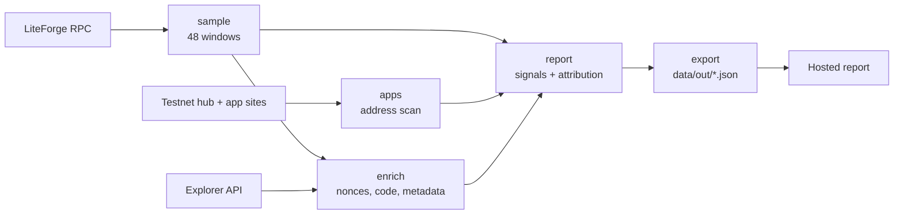

# Headcount


**Real users, counted.**

Most activity on the LitVM testnet comes from scripted wallets farming for rewards, so an app full of bots looks as busy as an app full of people.
Headcount reads the chain, scores every wallet on plain behaviour rules, and reports how much of each app's traffic looks scripted.
Honest builders get a number they can show; everyone else gets a fair leaderboard.

Live report: [LiteForge Headcount](https://claude.ai/artifact/SS51tXbv5cKbRRAGAdL51J) (private for now) · Data from LitVM LiteForge testnet (chain 4441).

[See it in one command](#see-it-in-one-command) · [The one rule](#the-one-rule) · [First findings](#first-findings) · [What's real vs pending](#whats-real-vs-pending) · [Tests](#tests)

Built for the LitVM Builders Program (LiteForge testnet). MIT licensed.
Headcount labels behaviour, not intent, and makes no claim about who runs any wallet.

## Table of contents

- [See it in one command](#see-it-in-one-command)
- [The one rule](#the-one-rule)
- [What Headcount does](#what-headcount-does)
  - [Sample a day of blocks](#sample-a-day-of-blocks)
  - [Match contracts to apps](#match-contracts-to-apps)
  - [Score every wallet](#score-every-wallet)
  - [Publish the report](#publish-the-report)
- [First findings](#first-findings)
- [Architecture](#architecture)
- [Component by component](#component-by-component)
- [How it uses LitVM](#how-it-uses-litvm)
- [Engineering decisions and the hard problems](#engineering-decisions-and-the-hard-problems)
- [What's real vs pending](#whats-real-vs-pending)
- [Tests](#tests)
- [Configuration](#configuration)
- [Project layout](#project-layout)
- [Tech stack, credits, roadmap](#tech-stack-credits-roadmap)
- [Disclaimer and license](#disclaimer-and-license)

## See it in one command

```bash
cd headcount
python3 -m headcount all  # sample, match apps, enrich, score, export
```

The run reads about 5,800 blocks from the public LiteForge RPC and takes roughly an hour at its rate limit.
Results land in `data/out/*.json`, one file per report section.
Open `report/preview.html` through any static server to see the report locally.

## The one rule

**A label must be explainable by a rule a reader can check.**

1. *Signals are plain thresholds* - lifetime transactions, hours active, bursts, repeated calls - each stated in the report with its number.
2. *Every claim links to the chain* - example wallets and transactions open in the LiteForge explorer.
3. *Labels describe behaviour, never intent* - "likely scripted", not "bot", and the report says scripted traffic to an app does not mean the app sends it.

## What Headcount does

### Sample a day of blocks

Reading every block of a day through the public RPC takes most of a day, so Headcount reads 48 windows of 120 consecutive blocks, spaced evenly over 24 hours.
Because windows are spread evenly in time, the share of transactions per label is a fair estimate for the day.

```text
48 windows x 120 blocks = 5,760 blocks (1.7% of a day) -> 84,472 user transactions
```

### Match contracts to apps

Headcount reads the LitVM testnet hub's app directory, then scans each app's homepage, linked pages and scripts for contract addresses.
An address found in exactly one app's code belongs to that app; contracts from the same deployer inherit it; a contract or token name is the last resort.

### Score every wallet

| Signal | Rule |
| --- | --- |
| Very high volume | Over 10,000 lifetime transactions |
| Round the clock | Active in 20 or more of 24 UTC hours |
| Bursts | 6 or more transactions inside one 30-second window |
| One repeated call | 90% or more of transactions are one identical call |

Two or more signals is *likely scripted*, one is *possibly scripted*, none is *no signals*.

### Publish the report

`python3 -m headcount export` writes row files for the hosted report: headline figures, traffic per window, every hub app, example wallets, unmatched contracts and signal counts.

## First findings

Sample from Nov 6, 13:42 to Nov 7, 13:42 UTC, 2026.

| Measure | Value |
| --- | --- |
| Transactions from likely scripted wallets | 26.1% |
| Transactions from possibly scripted wallets | 48.8% |
| Transactions from wallets with no signals | 25.2% |
| Share to the busiest contract (Aura's staking contract) | 68.7% |
| Median lifetime txs, that contract's senders | 16,254 |
| Median lifetime txs, every other wallet | 125 |
| Traffic matched to a hub app | 83% |

The busiest contract runs at the same rate every hour, while other traffic follows a daily rhythm.

## Architecture

Two decisions shape the pipeline: every step writes a file the next step reads, and every network call goes through one paced client.



| Tier | Runs | Can it move funds? | Responsibility |
| --- | --- | --- | --- |
| Pipeline | Locally, on demand | No | Read the chain and the web, write JSON |
| Report | In the browser | No | Draw the exported rows |

## Component by component

| Module | Responsibility |
| --- | --- |
| `headcount/http.py` | curl-based HTTP and JSON-RPC client with shared pacing and 429 backoff |
| `headcount/sample.py` | Find window start blocks by timestamp and fetch them, resumable per window |
| `headcount/apps.py` | Read the hub directory and scan app frontends for addresses |
| `headcount/enrich.py` | Lifetime nonces, contract code checks, explorer metadata, cached |
| `headcount/signals.py` | Per-wallet signals and labels (pure, tested) |
| `headcount/attribute.py` | Contract-to-app matching rules (pure, tested) |
| `headcount/report.py` | Aggregate per app, per window, per cohort |
| `headcount/export.py` | Flatten the report into row files |
| `report/index.html` | The report page |

## How it uses LitVM

**Reads:** `eth_getBlockByNumber`, `eth_getTransactionCount`, `eth_getCode` and `eth_getTransactionReceipt` on the LiteForge RPC; address metadata from the LiteForge explorer API; DIA and Goldsky are not used yet.

**Writes:** none yet.
An on-chain record of each report's fingerprint is on the roadmap.

## Engineering decisions and the hard problems

**Sampling over full reads.** The public RPC serves about five blocks a second and answers 429 when pushed, so a full day is out of reach; evenly spaced windows keep traffic shares unbiased.

**A shared funding wallet is not a signal here.** Nearly every wallet, person or script, is funded by the faucet, so funding-source clustering would flag everyone.

**Route-only code.** Aura's staking contract only appears in the code of its `/staking` page, so the scanner follows same-site links from each homepage.

**Never pool unknown deployers.** Contracts with no deployer on the explorer each stand alone; grouping them once merged unrelated contracts into one inflated figure.

**No rule changes after seeing the data.** Rotating wallets slip past the per-wallet round-the-clock signal; the report shows that pattern as its own finding instead of loosening thresholds.

## What's real vs pending

| Capability | Status |
| --- | --- |
| 24-hour sampling of LiteForge | Real - run on Nov 6-7, 2026 |
| Wallet signals and labels | Real - 20 unit tests |
| App matching from frontend code | Real - 47 of 95 hub apps |
| Hosted report | Real - private link |
| Builder-facing website | Not yet established |
| Daily scheduled scans | Not yet established |
| Public leaderboard | Not yet established |
| On-chain report fingerprints | Not yet established |

48 hub apps could not be matched: bot checks (not bypassed), timeouts, or contracts their code does not reveal.
There is no labelled ground truth, so labels are behaviour estimates, not verdicts.

## Tests

| Suite | Tests | Covers |
| --- | --- | --- |
| `tests/test_signals.py` | 8 | Wallet aggregation, thresholds, labels |
| `tests/test_attribute.py` | 6 | Frontend, deployer, name and shared rules |
| `tests/test_apps.py` | 4 | Scan merging, address pattern |
| `tests/test_export.py` | 2 | Category names |

```bash
cd headcount
python3 -m unittest discover -s tests -t .
```

## Configuration

| Variable | Purpose |
| --- | --- |
| `LITEFORGE_RPC` | JSON-RPC endpoint, default the published Caldera URL |
| `LITEFORGE_EXPLORER_API` | Explorer API base, default the published Caldera explorer |
| `LITEFORGE_RPC_INTERVAL` | Seconds between RPC requests across threads, default 0.35 |

LitVM is moving its infrastructure from Caldera to Zeeve, so these endpoints will change.

## Project layout

```text
headcount/
├── headcount/          # pipeline package: python3 -m headcount <step>
├── tests/              # unit tests for the pure logic
├── report/
│   ├── index.html      # report page
│   └── preview.html    # local preview with a stand-in runtime
└── data/
    └── out/            # exported report rows (raw scan data is gitignored)
```

## Tech stack, credits, roadmap

### Tech stack

Python 3.13 standard library, curl, d3 v7.

### Credits

LitVM and the LiteForge testnet, Caldera (RPC and explorer), the 4byte directory for function names.

### Roadmap

- Builder-facing website: pick an app, get a shareable real-users report
- Daily scheduled scans with trends
- Public leaderboard ranked by real users
- Report fingerprints recorded on LitVM

## Disclaimer and license

Headcount estimates behaviour from public chain data and is not a judgment of any person, app or team; labels can be wrong in both directions.

**MIT License.**
