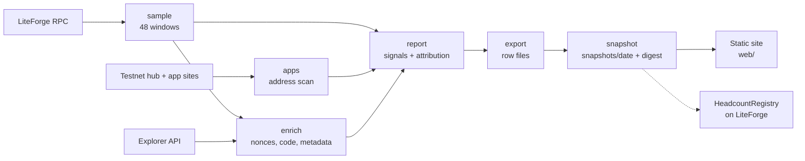

# Headcount


**Real users, counted.**

Most activity on the LitVM testnet comes from scripted wallets farming for rewards, so an app full of bots looks as busy as an app full of people.
Headcount reads the chain, scores every wallet on plain behaviour rules, and reports how much of each app's traffic looks scripted.
Honest builders get a number they can show; everyone else gets a fair leaderboard.

Live report: [LiteForge Headcount](https://claude.ai/artifact/SS51tXbv5cKbRRAGAdL51J) (private for now) · Data from LitVM LiteForge testnet (chain 4441).

[See it in one command](#see-it-in-one-command) · [The one rule](#the-one-rule) · [First findings](#first-findings) · [What's real vs pending](#whats-real-vs-pending) · [Tests](#tests)

Built for the LitVM Builders Program (LiteForge testnet). MIT licensed.
Headcount labels behaviour, not intent, and makes no claim about who runs any wallet.

## Table of contents

- [See it in one command](#see-it-in-one-command)
- [The one rule](#the-one-rule)
- [What Headcount does](#what-headcount-does)
  - [Sample a day of blocks](#sample-a-day-of-blocks)
  - [Match contracts to apps](#match-contracts-to-apps)
  - [Score every wallet](#score-every-wallet)
  - [Publish the report](#publish-the-report)
  - [Record each fingerprint on LitVM](#record-each-fingerprint-on-litvm)
- [First findings](#first-findings)
- [Architecture](#architecture)
- [Component by component](#component-by-component)
- [How it uses LitVM](#how-it-uses-litvm)
- [Engineering decisions and the hard problems](#engineering-decisions-and-the-hard-problems)
- [What's real vs pending](#whats-real-vs-pending)
- [Tests](#tests)
- [Configuration](#configuration)
- [Deploy](#deploy)
- [Project layout](#project-layout)
- [Tech stack, credits, roadmap](#tech-stack-credits-roadmap)
- [Disclaimer and license](#disclaimer-and-license)

## See it in one command

```bash
cd headcount
python3 -m headcount all  # sample, match apps, enrich, score, export, snapshot
```

```bash
cd headcount/web
pnpm install && pnpm dev  # leaderboard at http://localhost:3000
```

The scan reads about 5,800 blocks from the public LiteForge RPC and takes roughly an hour at its rate limit.
Each run writes a dated snapshot to `snapshots/<YYYY-MM-DD>/` with a SHA-256 fingerprint, and the site is built from those snapshots.
A free Render service runs the scan every day and pushes the snapshot; see [Deploy](#deploy).

## The one rule

**A label must be explainable by a rule a reader can check.**

1. *Signals are plain thresholds* - lifetime transactions, hours active, bursts, repeated calls - each stated in the report with its number.
2. *Every claim links to the chain* - example wallets and transactions open in the LiteForge explorer.
3. *Labels describe behaviour, never intent* - "likely scripted", not "bot", and the report says scripted traffic to an app does not mean the app sends it.

## What Headcount does

### Sample a day of blocks

Reading every block of a day through the public RPC takes most of a day, so Headcount reads 48 windows of 120 consecutive blocks, spaced evenly over 24 hours.
Because windows are spread evenly in time, the share of transactions per label is a fair estimate for the day.

```text
48 windows x 120 blocks = 5,760 blocks (1.7% of a day) -> 84,472 user transactions
```

### Match contracts to apps

Headcount reads the LitVM testnet hub's app directory, then scans each app's homepage, linked pages and scripts for contract addresses.
An address found in exactly one app's code belongs to that app; contracts from the same deployer inherit it; a contract or token name is the last resort.

### Score every wallet

| Signal | Rule |
| --- | --- |
| Very high volume | Over 10,000 lifetime transactions |
| Round the clock | Active in 20 or more of 24 UTC hours |
| Bursts | 6 or more transactions inside one 30-second window |
| One repeated call | 90% or more of transactions are one identical call |

Two or more signals is *likely scripted*, one is *possibly scripted*, none is *no signals*.

### Publish the report

`python3 -m headcount export` writes row files: headline figures, traffic per window, every hub app, example wallets, unmatched contracts and signal counts.
`python3 -m headcount snapshot` stores them under `snapshots/<date>/` with a fingerprint over the files, and the site in `web/` turns every snapshot into a leaderboard, one page per app and a method page.

### Record each fingerprint on LitVM

`contracts/src/HeadcountRegistry.sol` keeps one fingerprint per UTC day and never lets a day change.
Anyone can recompute a snapshot's digest and call `verify(day, digest)`.

## First findings

Sample from Nov 6, 13:42 to Nov 7, 13:42 UTC, 2026.

| Measure | Value |
| --- | --- |
| Transactions from likely scripted wallets | 26.1% |
| Transactions from possibly scripted wallets | 48.8% |
| Transactions from wallets with no signals | 25.2% |
| Share to the busiest contract (Aura's staking contract) | 68.7% |
| Median lifetime txs, that contract's senders | 16,254 |
| Median lifetime txs, every other wallet | 125 |
| Traffic matched to a hub app | 83% |

The busiest contract runs at the same rate every hour, while other traffic follows a daily rhythm.

## Architecture

Two decisions shape the pipeline: every step writes a file the next step reads, and every network call goes through one paced client.



| Tier | Runs | Can it move funds? | Responsibility |
| --- | --- | --- | --- |
| Pipeline | Daily on a free Render web service, or locally | No | Read the chain and the web, write a dated snapshot |
| Site | Static site on Render, rebuilt from snapshots | No | Leaderboard, app pages, method |
| Registry | LiteForge contract | No | Hold one fingerprint per day, forever |

## Component by component

| Module | Responsibility |
| --- | --- |
| `headcount/http.py` | curl-based HTTP and JSON-RPC client with shared pacing and 429 backoff |
| `headcount/sample.py` | Find window start blocks by timestamp and fetch them, resumable per window |
| `headcount/apps.py` | Read the hub directory and scan app frontends for addresses |
| `headcount/enrich.py` | Lifetime nonces, contract code checks, explorer metadata, cached |
| `headcount/signals.py` | Per-wallet signals and labels (pure, tested) |
| `headcount/attribute.py` | Contract-to-app matching rules (pure, tested) |
| `headcount/report.py` | Aggregate per app, per window, per cohort |
| `headcount/export.py` | Flatten the report into row files |
| `headcount/snapshot.py` | Store dated snapshots, fingerprint them, keep the index |
| `web/app/page.tsx` | Leaderboard, chain-wide shares, the busiest-contract story |
| `web/app/apps/[id]/page.tsx` | One page per hub app: shares, example wallets, matched contracts, trend |
| `web/app/method/page.tsx` | Signals, sampling, matching, limits, how to verify a snapshot |
| `contracts/src/HeadcountRegistry.sol` | Append-only daily fingerprints with `verify` |
| `headcount/server.py` | Render runner: starts a scan on an authenticated `POST /run`, stays awake while it runs, pushes the snapshot |
| `render.yaml` | Render Blueprint for the runner and the static site, both on the free tier |
| `.github/workflows/daily-scan.yml` | Manual scan on GitHub Actions, with fingerprint publishing |
| `report/index.html` | The hosted report page |

## How it uses LitVM

**Reads:** `eth_getBlockByNumber`, `eth_getTransactionCount`, `eth_getCode` and `eth_getTransactionReceipt` on the LiteForge RPC; address metadata from the LiteForge explorer API; DIA and Goldsky are not used yet.

**Writes:** one `publish(day, digest, uri)` call a day to `HeadcountRegistry`, once the contract is deployed and the daily job has its publisher key.
The contract is not deployed yet.

## Engineering decisions and the hard problems

**Sampling over full reads.** The public RPC serves about five blocks a second and answers 429 when pushed, so a full day is out of reach; evenly spaced windows keep traffic shares unbiased.

**A shared funding wallet is not a signal here.** Nearly every wallet, person or script, is funded by the faucet, so funding-source clustering would flag everyone.

**Route-only code.** Aura's staking contract only appears in the code of its `/staking` page, so the scanner follows same-site links from each homepage.

**Never pool unknown deployers.** Contracts with no deployer on the explorer each stand alone; grouping them once merged unrelated contracts into one inflated figure.

**No rule changes after seeing the data.** Rotating wallets slip past the per-wallet round-the-clock signal; the report shows that pattern as its own finding instead of loosening thresholds.

## What's real vs pending

| Capability | Status |
| --- | --- |
| 24-hour sampling of LiteForge | Real - run on Nov 6-7, 2026 |
| Wallet signals and labels | Real - unit tested |
| App matching from frontend code | Real - 47 of 95 hub apps |
| Dated snapshots with fingerprints | Real - `snapshots/2026-11-07` |
| Leaderboard, app pages, method page | Real - builds locally; Render static site defined, not deployed yet |
| Daily scheduled scans | Built - Render runner tested locally; not deployed yet |
| Registry contract | Built - 12 Foundry tests; not deployed |
| On-chain report fingerprints | Not yet established |

48 hub apps could not be matched: bot checks (not bypassed), timeouts, or contracts their code does not reveal.
There is no labelled ground truth, so labels are behaviour estimates, not verdicts.

## Tests

| Suite | Tests | Covers |
| --- | --- | --- |
| `tests/test_signals.py` | 8 | Wallet aggregation, thresholds, labels |
| `tests/test_attribute.py` | 6 | Frontend, deployer, name and shared rules |
| `tests/test_apps.py` | 4 | Scan merging, address pattern |
| `tests/test_export.py` | 2 | Category names |
| `tests/test_snapshot.py` | 5 | Snapshot folders, digest stability, index order, fresh-scan reset |
| `tests/test_server.py` | 10 | Run auth, one scan at a time, health, token redaction, real clone-scan-commit-push against a local repo |
| `contracts/test/HeadcountRegistry.t.sol` | 12 | Publish, overwrite and owner guards, day checks, two-step ownership, fuzzed `verify` |

```bash
cd headcount
python3 -m unittest discover -s tests -t .
```

```bash
cd headcount/contracts
forge test -vv
```

The site is checked with `tsc --noEmit`, ESLint and a full static build in CI.

## Configuration

| Variable | Purpose |
| --- | --- |
| `LITEFORGE_RPC` | JSON-RPC endpoint, default the published Caldera URL |
| `LITEFORGE_EXPLORER_API` | Explorer API base, default the published Caldera explorer |
| `LITEFORGE_RPC_INTERVAL` | Seconds between RPC requests across threads, default 0.35 |
| `HEADCOUNT_WINDOWS` | Sample windows per scan, default 48 |
| `HEADCOUNT_BLOCKS_PER_WINDOW` | Consecutive blocks per window, default 120 |
| `NEXT_PUBLIC_HEADCOUNT_REGISTRY` | Registry address shown on the site's method page |

| `RUN_TOKEN` | Runner: bearer token the scheduler sends to `POST /run` (Render generates it) |
| `GITHUB_TOKEN` | Runner: fine-grained token with Contents read and write on this repository only |
| `GITHUB_REPOSITORY` | Runner: repository to clone and push, default `Saber1Y/headcount` |

The manual GitHub workflow reads the repository variable `HEADCOUNT_REGISTRY` and the secret `REGISTRY_PUBLISHER_KEY`; without both it publishes nothing on-chain.

LitVM is moving its infrastructure from Caldera to Zeeve, so these endpoints will change.

## Deploy

Everything runs on free tiers: two Render services and one free scheduler.

### 1. Render

In the Render dashboard choose **New > Blueprint**, pick this repository, and apply `render.yaml`.
It creates `headcount-runner` (free web service) and `headcount-site` (free static site).
When asked for `GITHUB_TOKEN`, paste a fine-grained GitHub token limited to this repository with *Contents: Read and write*.

### 2. Daily trigger

A free Render service sleeps between requests and has no cron, so a free scheduler such as cron-job.org starts each scan:

| Setting | Value |
| --- | --- |
| URL | `https://<headcount-runner>.onrender.com/run` |
| Method | `POST` |
| Header | `Authorization: Bearer <RUN_TOKEN from the Render dashboard>` |
| Schedule | Daily, 14:15 UTC |

The runner answers `202` and keeps itself awake until the scan ends, then sleeps.
`GET /health` shows the last run's status and message.

### 3. Check

```bash
curl https://<headcount-runner>.onrender.com/health
```

## Project layout

```text
headcount/
├── headcount/          # pipeline package: python3 -m headcount <step>
├── tests/              # unit tests for the pure logic
├── snapshots/          # one folder per day + index.json, the site's data
├── web/                # Next.js static site
├── contracts/          # HeadcountRegistry (Foundry)
├── report/
│   ├── index.html      # hosted report page
│   └── preview.html    # local preview with a stand-in runtime
├── .github/workflows/  # CI and the daily scan
└── data/               # raw scan data and caches (gitignored)
```

## Tech stack, credits, roadmap

### Tech stack

Python 3.13 standard library and curl for the pipeline, Next.js 16 and React 19 for the site, Solidity 0.8.28 and Foundry for the registry.

### Credits

LitVM and the LiteForge testnet, Caldera (RPC and explorer), the 4byte directory for function names.

### Roadmap

- Deploy the registry on LiteForge and turn on daily publishing
- Host the site
- Check any contract address on demand, not only hub apps
- Detect rotating wallet pools at the contract level

## Disclaimer and license

Headcount estimates behaviour from public chain data and is not a judgment of any person, app or team; labels can be wrong in both directions.

**MIT License.**
